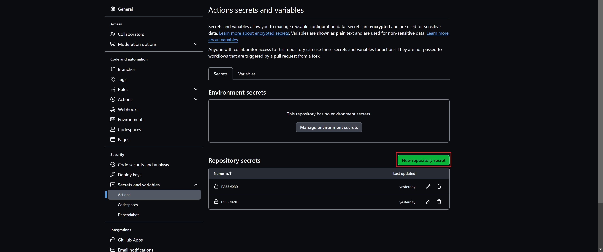
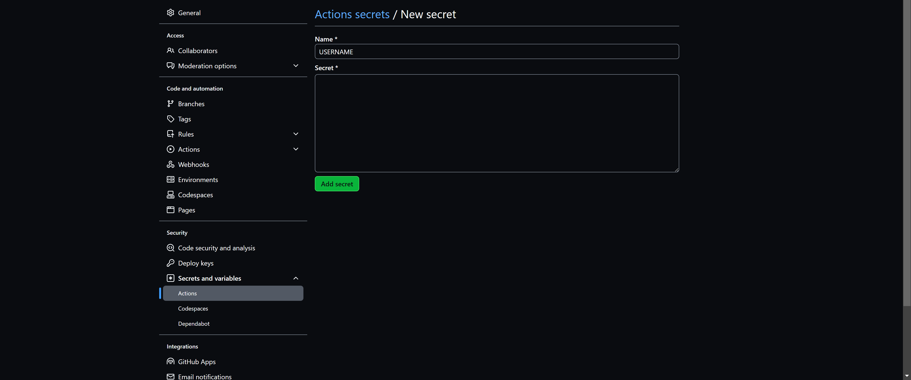

# easonFansForumDaily
自动完成神经研究所每日任务

## 文件说明
- dailyMission.py 保存了完成每日任务的脚本，包括签到、答题和摩天轮抽奖。
- question_bank.py 管理题库；question_bank.json 保存每次提交的题目、选项、答案及判定结果。

## 题库与自动回写

每次答题先查本地题库：有已确认的正确答案就直接选择，不调用 API；只有错误记录时，从候选选项中排除这些答案后调用原来的 API；未收录的题目沿用现有 API 流程。API 调用方式、响应解析和调用计数规则保持不变，API 失败时仍使用备选答案，但不会选择已知错误选项。即使只剩一个选项，也会按原流程调用 API；所有选项都被排除时停止答题，等待检查题库。

题库使用题目文本与选项文本集合匹配，同一题的选项顺序变化不会影响复用。每条记录包含提交时间、当时的选项标签与文本、所选答案、来源（题库/API/备选）和 `correct` 字段：`true` 表示正确、`false` 表示错误、`null` 表示尚未确认。错误答案只从候选项中排除，历史记录仍保留。只有网站的“累计答题”增加 1 且“累计答对”增加 0 或 1，才会判定对错；无法确认时保留未知记录并停止本次答题，不会把提交成功当作答对。题库不保存账号、密码或 API Key。

GitHub Actions 中两个账号共享同一个题库。运行结束后（包括中途失败），workflow 会备份 `question_bank.json` 为 artifact，并在有变化时通过 `github-actions[bot]` 自动提交、推送到当前仓库的运行分支；只有题库发生变化不会再次触发答题。相同分支的运行会串行执行，避免题库互相覆盖，也支持从 Actions 页面手动运行。

将这些代码变更推送到 GitHub 后即可启用。workflow 已声明 `contents: write`，使用默认 `GITHUB_TOKEN`，无需新增 token secret。如果仓库或组织策略禁止 Actions 写入，或分支保护不允许 bot 直接推送，需要允许该权限/分支写入；推送失败时仍可从 Actions 的 artifact 下载题库备份。

本地运行也会更新脚本同目录下的 `question_bank.json`，可自行随代码提交。不要删除已有题库文件，否则会丢失已积累的答案。运行测试：`python -m unittest discover -s tests -v`（先安装 requirements.txt）。

## 使用方法
fork本repositroy后，在Settings->Secrets中新建仓库密码（New repository secret）。
- 添加Name为`USERNAME`和`PASSWORD`的环境变量，分别添加自己神经研究所的账号和密码。
- 添加Name为`MAIL_USERNAME`和`MAIL_PASSWORD`的环境变量，分别添加自己邮箱的SMTP账号和密码。
- 如需使用LLM回答问题需要在[阿里百炼平台](https://bailian.console.aliyun.com)申请apikey并添加`API_KEY`的环境变量，否则随机选择。
- `API_KEY`如果不需要也建议设置为0。



## 本地运行
1. Clone this repo and install prerequisites:

    ```bash
    # Clone this repo
    git clone git@github.com:TannerTam/easonFansForumDaily.git
    
    # Create a Conda environment
    conda create -n easonFansForumDaily python=3.10.0
    conda activate easonFansForumDaily
    
    # Install prequisites
    pip install -r requirements.txt
    # Install packages
    sudo apt update
    sudo apt install tesseract-ocr
    ```

2. 在本地新建`config.json`文件，内容为

    ```json
    {
        "USERNAME": "",
        "PASSWORD": "",
        "MAIL_USERNAME": "",
        "MAIL_PASSWORD": "",
        "API_KEY":""
    }
    ```
3. 在[网站](https://googlechromelabs.github.io/chrome-for-testing/#stable)下载与自己chrome版本相符合的chrome driver，并将文件夹解压后放到当前目录
4. 运行

    ```bash
    #无头
    python dailyMission.py --local --headless
    
    #显示窗口
    python dailyMission.py --local
    ```
